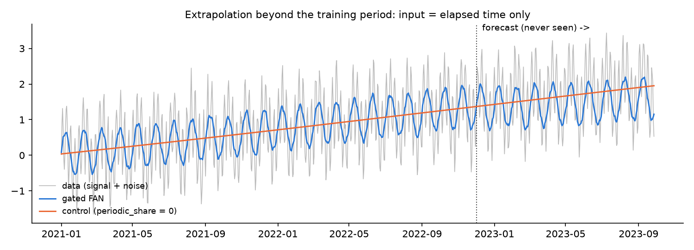

# fastGatedFourierAnalysisNetwork

**Gated Fourier Analysis Networks (gated FAN) on TensorFlow, PyTorch or JAX, with the fastANN / fastLSTM workflow: build, train, version and reuse a network that learns periodic components, in a few lines of code.**

```python
from fastGatedFourierAnalysisNetwork import fastGatedFAN

fan = fastGatedFAN(X_data = X_df, Y_data = Y_df, model_relative_width = [8, 4], model_dropout = [0.3, 0.2],
                   data_storage_path = './models/', model_name = 'signal')
fan.network_structure_set_compile()
fan.network_training(epochs = 200, batch_size = 256)      # saves model, scalers, data, history, hyperparameters
fan.network_predictions_evaluation(min_probability = 0.5)
fan.periodic_components_report()                          # how much periodic modelling the network kept
```

**Current version: 1.0.1** (`fastGatedFourierAnalysisNetwork.__version__`) — see the [CHANGELOG](CHANGELOG.md).

## Contents

1. [What a gated FAN is](#what-a-gated-fan-is)
2. [Why it can help: periodicity and projections into the future](#why-it-can-help-periodicity-and-projections-into-the-future)
3. [Evidence and honest limits](#evidence-and-honest-limits)
4. [Installation](#installation)
5. [Quick start](#quick-start)
6. [Network architecture and parameters](#network-architecture-and-parameters)
7. [Methods reference](#methods-reference)
8. [Saved files and model versioning](#saved-files-and-model-versioning)
9. [Training on several devices (two GPUs, TPU)](#training-on-several-devices-two-gpus-tpu)
10. [Examples](#examples)
11. [Practical guide: choosing the settings](#practical-guide-choosing-the-settings)
12. [Same API as fastANN and fastLSTM](#same-api-as-fastann-and-fastlstm)
13. [References](#references)

---

## What a gated FAN is

A multilayer perceptron (MLP) builds every hidden unit as `act(x W + b)`: piecewise-linear (ReLU) or smooth (GELU) functions that are very good at interpolating *inside* the range of the training data, but that have no notion of repetition. Outside that range they continue as straight lines or flatten out.

A **Fourier Analysis Network** (FAN, Dong et al., 2024) replaces each dense hidden layer with one whose output contains, **side by side**, a periodic part and an ordinary part:

```
FAN(x) = [ cos(x Wp) , sin(x Wp) , act(x Wp_bar + b) ]
          \______ periodic ______/  \__ non-periodic __/
```

* `Wp` holds **learnable frequencies**: every periodic unit is a sinusoid along a learned direction of the input (a combination of features, or the time), with period `2π / |Wp[:, j]|`.
* `Wp_bar`, `b` and `act` (GELU by default) are a normal dense layer.

Stacking FAN layers lets the network compose periodic and non-periodic functions (a cycle whose amplitude grows with a trend, a seasonal pattern that depends on a regime, ...), in the same way an MLP composes ReLUs.

The **gated** variant used here adds one trainable gate `g = sigmoid(gate) ∈ (0, 1)` per frequency:

```
GatedFAN(x) = [ g · cos(x Wp) , g · sin(x Wp) , (1 − mean(g)) · act(x Wp_bar + b) ]
```

The gates start at 0.5 and are learned with the other weights: the network decides, layer by layer and frequency by frequency, how much periodic modelling it needs, and can switch it off on data without periodic structure. `periodic_components_report()` shows the gates and the learned periods after training.

## Why it can help: periodicity and projections into the future

1. **Extrapolation of cycles.** A sinusoid keeps oscillating after the end of the training data, a ReLU/GELU unit does not. When an input is the elapsed time (see `time_index_feature`), the periodic units become daily, weekly or seasonal cycles that can be **projected beyond the training period**, while the non-periodic units model the trend. An MLP can only fit the cycles it has seen and extends them as straight lines.
2. **Compact representation of oscillations.** A periodic pattern that an MLP must approximate with many ReLU "kinks" is one or two sinusoids for a FAN: fewer parameters for the same in-sample fit, which the FAN paper also reports on several benchmarks.
3. **Periodic structure in features, not only in time.** Phases (hour of the day, day of the week, angle-like indicators), oscillators and cyclic regimes enter the network as directions along which a learned sinusoid can act.
4. **No cost when it is not needed.** With the gates the network can reduce the periodic part where it does not help, and `periodic_share = 0` gives an exact plain-MLP control with the same pipeline, so the benefit can always be measured instead of assumed.
5. **Multi-step forecasts.** Several target columns (e.g. `y(t+1) ... y(t+k)`) are predicted together, as in fastANN; the periodic units share the same learned cycles across all horizons.

## Evidence and honest limits

**Extrapolation benchmark** (`examples/extrapolation_benchmark.py`, CPU, a few minutes). 1,000 daily points: weekly cycle + 30.4-day cycle + linear trend + noise (σ 0.15). The only input is the elapsed time. Training on the first 70%, forecast of the following **300 days never seen**; early stopping and checkpoint look only at the training loss. Error = RMSE against the noiseless signal.

| Model (same pipeline, 1,000 days, forecast of the last 300) | First-layer frequencies | RMSE training | RMSE forecast (5 seeds, mean ± std) |
|---|---|---|---|
| Control: `periodic_share = 0`, `model_relative_width = [64]` | - | 0.824 | 0.830 ± 0.007 |
| **Gated FAN** `[64]`, `periodic_share = 0.5` | `frequency_init = 'log_periods'`, `init_periods = (2, 700)` | **0.707** | **0.734 ± 0.022** |
| Gated FAN `[256]`, `periodic_share = 0.5` | random, `frequency_init_std = 90` | 0.595 ± 0.297 | 0.867 ± 0.473 (best seed 0.230) |

The chart shows seed 1 of the first two rows.



What this shows, and what it does not:

* The control network (same pipeline, `periodic_share = 0`) learns the trend only: it cannot represent the cycles even inside the training period, and its forecast is a straight line.
* Gated FAN layers **can** represent the cycles and project them: with random initial frequencies one seed out of five locked onto both cycles and forecast 300 days with RMSE 0.23 (control 0.83). But **learning frequencies by gradient descent is unreliable**: the other seeds stayed close to the trend-only solution or projected spurious cycles, and on average random initialisation was no better than the control (0.87 vs 0.83).
* The deterministic `frequency_init = 'log_periods'` grid removes the dependence on the seed and gives a consistent, moderate gain with one hidden layer (table above): in the chart the network has learned the 30.4-day cycle and keeps it for the 300 forecast days, while the control can only continue the trend. The weekly cycle, however, is not captured (it is left in the residual), so the error is reduced by about 12%, not removed. Deeper and wider stacks fit the training period much better (RMSE 0.15) but extrapolate worse: they also fit noise with frequencies that keep oscillating in the future.
* **In practice:** for forecasting with a time input use one layer, `log_periods`, several seeds, and select on a validation period that comes *after* the training period. Treat the periodic extrapolation as something to verify on your data, not as a guarantee.
* **Tabular classification.** On a real dataset (SPY option chains, 2.8 M rows, 46 features, "will this call expire in the money?"), gated FAN networks performed like plain dense networks of the same size (test AUC 0.970 vs 0.970; on the hard subset, strikes within 2% of the underlying, 0.659 vs 0.650), and wide FAN networks with high dropout (×256/×64/×8, dropout 0.9) reached 0.976 and 0.701. In all these runs the gates stayed at about 0.5 (their initial value): the gate parameters receive small gradients and move slowly. Compare with `periodic_share = 0` (same code, same files) before relying on a FAN for your problem.

## Installation

```bash
pip install git+https://github.com/fede72bari/fastGatedFourierAnalysisNetwork.git
pip install tensorflow          # TensorFlow backend (includes Keras 3)
# or
pip install keras torch         # PyTorch backend
# or
pip install keras jax           # JAX backend (TPU: jax[tpu])
```

or clone the repository and add its folder to the Python path, as for fastANN:

```python
import sys
sys.path.append('/path/to/fastGatedFourierAnalysisNetwork')   # the cloned repository folder
from fastGatedFourierAnalysisNetwork import fastGatedFAN
```

Requirements: Python 3.9+, Keras 3 with **one** backend (`tensorflow` 2.16+, `torch` **or** `jax`; JAX is the one for TPUs), `numpy`, `pandas`, `scikit-learn`, `joblib`, `matplotlib`, `plotly`, `ipython`. Unlike fastANN, the module imports only what it uses. Tested with Keras 3.15 on TensorFlow 2.21 and PyTorch 2.14, pandas 3.0, scikit-learn 1.9.

## Quick start

```python
from fastGatedFourierAnalysisNetwork import fastGatedFAN, time_index_feature

# X_df: features, one row per sample (time order for time series); Y_df: targets (here a 0/1 column 'signal')
fan = fastGatedFAN(X_data = X_df,
                   Y_data = Y_df[['signal']],
                   model_relative_width = [8, 4],     # two hidden gated FAN layers: 8x and 4x the number of features
                   model_dropout = [0.3, 0.2],
                   periodic_share = 1 / 3,            # 1/3 of every layer output is cos/sin, 2/3 is GELU
                   data_storage_path = './models/',   # must end with a separator
                   model_name = 'signal')

fan.network_structure_set_compile()                  # build + compile
fan.network_training(epochs = 200, batch_size = 256) # train, save everything, reload the best epoch

results_df, probabilities_df = fan.network_predictions_evaluation(min_probability = 0.5)
fan.periodic_components_report()                     # gates and learned periods per layer
```

Later, in another session (TensorFlow, PyTorch or JAX, whichever trained the model):

```python
fan = fastGatedFAN()
fan.load_all('2026-10-04 10-00-00 - HYPERPARAMETERS OF GATED FAN MODEL - signal.json', file_path_name = './models/')
predictions = fan.model_predict(new_X_df)            # scaled inside, descaled if needed
```

## Network architecture and parameters

`model_relative_width` lists the hidden layers, as in fastANN; input and output layers are added automatically:

```
input (n_features)
GatedFAN(n_features * model_relative_width[0]) + Dropout(model_dropout[0])
...
GatedFAN(n_features * model_relative_width[-1]) + Dropout(model_dropout[-1])
Dense(n_targets, last_layer_activation)
```

Each `GatedFAN` layer of `units` outputs has `d_p = round(units * periodic_share / 2)` frequencies (a cosine and a sine each) and `units - 2 * d_p` non-periodic units. Example with 46 features and `model_relative_width = [256, 64, 8]`:

| Layer | Units | Periodic (cos + sin) | Non-periodic (GELU) |
|---|---|---|---|
| GatedFAN 0 | 11,776 | 2 × 1,963 | 7,850 |
| GatedFAN 1 | 2,944 | 2 × 491 | 1,962 |
| GatedFAN 2 | 368 | 2 × 61 | 246 |

### Constructor parameters

All fastANN parameters are available with the same names and meaning (`X_data`, `Y_data`, pre-split `X_train_s` / `Y_train` / `X_test_s` / `Y_test`, `split_type`, `model_relative_width`, `model_dropout`, `learning_rate`, `last_layer_activation`, `loss`, `metrics`, early stopping and checkpoint settings, `history_metrics`, `save_best_only`, `early_stop_patience`, `autoencoder_mode`, `train_size_rate`, `save_X_Y_data`, `data_storage_path`, `model_name`, `scale_targets`, `shuffle`, `backend`). Differences and additions:

| Parameter | Default | Meaning |
|---|---|---|
| `activation` | `'gelu'` | Activation of the **non-periodic** part (any Keras activation name). `'PReLU'` of fastANN is not available. |
| `periodic_share` | `1/3` | Share of each hidden layer output given to the cosine + sine pairs. `0` = plain dense layers (control model). |
| `gated` | `True` | Trainable gate per frequency. `False` = original, ungated FAN layer. |
| `frequency_init_std` | `1.0` | Standard deviation of the normal initialisation of the frequencies. Inputs are standardized: a cycle of period `P` (in original units) of a feature with standard deviation `σ` has frequency `2π σ / P`. Set it to cover the cycles you expect (see the [practical guide](#practical-guide-choosing-the-settings)). |
| `min_frequency`, `max_frequency` | `None` | Bounds on `|Wp|`, enforced after every optimizer step: e.g. forbid periods longer than the training window or shorter than the sampling step. |
| `frequency_init` | `'normal'` | Initialisation of the first layer frequencies: `'normal'` (random directions, `N(0, frequency_init_std)`) or `'log_periods'` (deterministic grid, see `init_periods`). |
| `init_periods` | `None` | `(shortest, longest)` period of the `'log_periods'` grid in the ORIGINAL units of the features (e.g. `(2, 365)` days for a time feature in days). Frequency `j` acts on feature `j mod n_features` with the `j`-th period of a log-spaced grid; training then refines it. |
| `model_relative_width` | `[4]` | Output width of each hidden layer relative to the number of features. |
| `sample_weight` | `None` | One weight per row of `X_data`: the training rows weight the loss (e.g. larger weights for the hard cases). Not saved in the files (only whether it was used). |
| `monitor_auc` | `False` | ROC AUC of the test-set predictions computed at the end of every epoch and logged as `val_monitored_auc`: use it as `early_stop_monitor_metric` / `checkpoint_monitor_metric` with mode `'max'` to choose the epoch on the AUC. |
| `monitor_auc_rows` | `None` | One flag per row of `X_data`: the monitored AUC uses only the selected test rows (e.g. the hard cases). Implies `monitor_auc = True`. |
| `distribution_strategy` | `None` | TensorFlow only: the network is built, compiled and loaded inside its scope, so that `fit` trains on all its devices, e.g. `tf.distribute.MirroredStrategy()` for two GPUs (see [Training on several devices](#training-on-several-devices-two-gpus-tpu)). |
| `batch_multiple` | `None` | Arrays are completed to a multiple of it (last row repeated with weight 0) so that every batch splits evenly among the devices. `None` uses the number of devices of the active Keras distribution (8 with `keras.distribution.DataParallel` on a TPU v5e-8) and 1 without distribution. |
| `model_name` | `'GatedFAN'` | Name used in the saved files. |

## Methods reference

Same methods as fastANN, with the same signatures:

| Group | Methods |
|---|---|
| Build and train | `network_structure_set_compile()`, `network_training(epochs, batch_size, callbacks = None)`, `early_stop_patience_set(patience)`, `checkpoint_callback(save_best_only)` |
| Evaluate | `network_predictions_evaluation(min_probability, output_dict = False)`, `binary_precision_recall_vs_scoring(n_points, plot)`, `plot_training_history()`, `gradient_feature_importance(feature_names)` |
| Predict | `model_predict(data, apply_scaler = True, descale_result = True)`, `predict_array(X)` (`model.predict` on scaled inputs that also works with several devices) |
| Save and load | `load_all(hyperparameters_file_name, file_path_name)`, `load_model()`, `load_scaler()`, `load_training_history()`, `load_hyperparameters()`, `save_hyperparameters()` |
| Data | `split_and_scale(scaler_fit)`, `effective_batch_multiple()` |
| **Gated FAN** | `periodic_components_report(plot = True)`: per layer, number of frequencies, mean/min/max gate, quartiles of the learned periods; optional chart of gate vs period of every frequency of the first layer. `initialize_log_periods(init_periods)`: deterministic first-layer frequencies (called automatically with `frequency_init = 'log_periods'`) |

Module functions: `fan_layers()` (the custom Keras objects `GatedFAN` and `FrequencyClip`, for use in your own Keras models or as `custom_objects`), `periodic_split(units, periodic_share)`, `time_index_feature(timestamps, unit, origin)`, `load_keras(backend)`.

## Saved files and model versioning

`network_training()` writes a complete, timestamped snapshot of the run into `data_storage_path` (`<dt>` = timestamp, `<name>` = `model_name`):

| File | Content |
|---|---|
| `<dt> - GATED FAN MODEL - <name>.keras` | Best (or last) model, saved at every improvement during training. |
| `<dt> - SCALER FOR GATED FAN MODEL - <name>.pkl` | Features scaler (fitted on the training rows only). |
| `<dt> - Y SCALER FOR GATED FAN MODEL - <name>.pkl` | Targets scaler (only with `scale_targets`). |
| `<dt> - TRAINING HISTORY OF GATED FAN MODEL - <name>.csv` | Loss and metrics per epoch. |
| `<dt> - HYPERPARAMETERS OF GATED FAN MODEL - <name>.json` | All settings (gated FAN ones included) and the names of the other files. |
| `<dt> - X_data / Y_data FOR GATED FAN MODEL - <name>.csv` | The dataset (with `save_X_Y_data`, default), so the same split can be rebuilt. |

The JSON is the entry point of the run: `fastGatedFAN().load_all(json_name, file_path_name = folder)` restores model, scalers, history and data. The best model is on disk from the first improving epoch, so an interrupted session (time limit, lost GPU) still leaves a usable checkpoint. A model trained with one backend reloads with the other. The versioning practices of the [fastANN README](https://github.com/fede72bari/fastANN#model-versioning-runs-datasets-and-hyperparameters) apply unchanged (replace `ANN MODEL` with `GATED FAN MODEL` in the file patterns).

## Training on several devices (two GPUs, TPU)

Data parallelism: every batch is split among the devices, each one computes the gradients of its share and the weights are updated with their average. Network, results and saved files are the same as on one device; only the time per epoch changes.

### Two or more GPUs (TensorFlow, e.g. Kaggle "GPU T4 x2")

```python
import tensorflow as tf

fan = fastGatedFAN(X_data = X_df, Y_data = Y_df, distribution_strategy = tf.distribute.MirroredStrategy(),
                   data_storage_path = './models/')
fan.network_structure_set_compile()                  # built and compiled inside strategy.scope()
fan.network_training(epochs = 100, batch_size = 4096) # each GPU gets 2048 rows per step
```

- The network is built, compiled and reloaded inside `strategy.scope()`. Entering the scope by hand (`strategy.scope().__enter__()`) is **not** enough with Keras 3: the variables are not distributed and `fit` fails with ``colocate_vars_with must only be passed a variable created in this tf.distribute.Strategy.scope()``.
- `batch_size` is the global batch, split among the GPUs. The same batch gives the same training as on one GPU; a larger one uses the GPUs better but changes the optimisation (fewer updates per epoch).
- Without `distribution_strategy` TensorFlow trains on **one** GPU even when two are visible.

### TPU (JAX, e.g. Kaggle TPU v5e-8, Google Colab TPU)

```python
import os
os.environ['KERAS_BACKEND'] = 'jax'
import jax, keras

keras.distribution.set_distribution(keras.distribution.DataParallel(devices = jax.devices()))   # 8 cores on a v5e-8
fan = fastGatedFAN(X_data = X_df, Y_data = Y_df, backend = 'jax', data_storage_path = './models/')
fan.network_structure_set_compile()
fan.network_training(epochs = 100, batch_size = 4096)
```

- With a Keras distribution every batch must split evenly among the devices, otherwise JAX stops with `IndivisibleError` (typically on the last, partial batch of the epoch). Training, validation and prediction arrays are completed to a multiple of the number of devices (`batch_multiple`, read from the active distribution: 8 on a v5e-8, 1 without distribution) by repeating the last row **with sample weight 0**, so loss and metrics do not change; the batch size must be a multiple of it.
- `predict_array(X)` is `model.predict` for this case (pads, predicts, drops the added rows); `model_predict`, the AUC monitor and `network_predictions_evaluation` use it.
- A TPU can be opened by one process only: if the notebook calls `jax.devices()` and then trains in a subprocess, the subprocess finds the TPU busy.
- Colab TPU runtimes have no TensorFlow: use `backend = 'jax'` (models trained there reload with TensorFlow or PyTorch).

The FAN layer itself has no device-specific code: on GPU it is a few matrix products, on TPU XLA fuses it with the rest of the network.

## Examples

### 1. Forecasting a series with cycles beyond the training period

```python
import pandas as pd
from fastGatedFourierAnalysisNetwork import fastGatedFAN, time_index_feature

X = pd.DataFrame({'t_days': time_index_feature(df.index, unit = 'D')})   # elapsed time is the input
Y = df[['value']]
fan = fastGatedFAN(X_data = X, Y_data = Y, model_relative_width = [64], model_dropout = [0],
                   periodic_share = 0.5,
                   frequency_init = 'log_periods', init_periods = (2, 700),    # periods from 2 to 700 days
                   last_layer_activation = 'linear', loss = 'mse', metrics = ['mae'], scale_targets = True,
                   history_metrics = ['loss', 'val_loss'],
                   early_stop_monitor_metric = 'loss', early_stop_mode = 'min',     # do not select on the forecast period
                   checkpoint_monitor_metric = 'loss', checkpoint_mode = 'min', early_stop_patience = 60,
                   learning_rate = 2e-3, data_storage_path = './models/', model_name = 'cycles')
fan.network_structure_set_compile()
fan.network_training(epochs = 800, batch_size = 32)
future = pd.DataFrame({'t_days': time_index_feature(future_index, unit = 'D', origin = df.index[0])})
forecast = fan.model_predict(future)
```

### 2. Classification with features, against its own MLP control

```python
from fastGatedFourierAnalysisNetwork import fastGatedFAN

settings = dict(X_data = X_df, Y_data = Y_df[['itm']], model_relative_width = [16, 8], model_dropout = [0.5, 0.3],
                learning_rate = 1e-4, early_stop_monitor_metric = 'val_loss', early_stop_mode = 'min',
                checkpoint_monitor_metric = 'val_loss', checkpoint_mode = 'min', early_stop_patience = 12,
                data_storage_path = './models/')
fan = fastGatedFAN(model_name = 'itm_fan', **settings)
mlp = fastGatedFAN(model_name = 'itm_mlp', periodic_share = 0, **settings)   # same pipeline, no periodic part
for m in (fan, mlp):
    m.network_structure_set_compile()
    m.network_training(epochs = 60, batch_size = 4096)
print(fan.periodic_components_report(plot = False))
```

### 3. Multi-step forecast

```python
# targets: y(t+1) ... y(t+8) as 8 columns; features: lags, indicators and the elapsed time
Y_multi = pd.concat({f'y_t+{k}': df['y'].shift(-k) for k in range(1, 9)}, axis = 1).dropna()
fan = fastGatedFAN(X_data = X_df.loc[Y_multi.index], Y_data = Y_multi, model_relative_width = [8, 4],
                   last_layer_activation = 'linear', loss = 'mse', metrics = ['mae'], scale_targets = True,
                   history_metrics = ['loss', 'val_loss'], early_stop_monitor_metric = 'val_loss', early_stop_mode = 'min',
                   checkpoint_monitor_metric = 'val_loss', checkpoint_mode = 'min', data_storage_path = './models/')
```

### 4. Using the layer in your own Keras model

```python
from fastGatedFourierAnalysisNetwork import fan_layers
import keras
GatedFAN = fan_layers()['GatedFAN']
model = keras.Sequential([keras.Input((n_features,)), GatedFAN(256), keras.layers.Dropout(0.3), keras.layers.Dense(1, activation = 'sigmoid')])
# saved models reload with keras.models.load_model(path, custom_objects = fan_layers())
```

## Practical guide: choosing the settings

* **Frequency initialisation.** With a time input, prefer `frequency_init = 'log_periods'` and `init_periods = (2 sampling steps, length of the training window)`: it covers every cycle the data can show and does not depend on the seed.
* **Frequency scale (random initialisation).** The first layer sees standardized inputs. For a time input with standard deviation `σ_t` (in days) and a cycle of `P` days the angular frequency is `2π σ_t / P`: choose `frequency_init_std` of that order for the shortest cycle you want to capture (e.g. `σ_t ≈ 200` days, weekly cycle → `2π·200/7 ≈ 180`; half of it is a good start). With the default 1.0 the initial periods are a few standard deviations of the input, which suits features but is far too slow for weekly cycles over years of data.
* **Width and depth for extrapolation.** For forecasting with time as input, one layer with `periodic_share = 0.5` is the most reliable start; deep and wide stacks fit the past better but can project spurious cycles. For classification/regression on features, the usual "width × number of features" stacks of fastANN work as they are.
* **Seeds and selection.** Frequencies learned by gradient descent depend on their initial values: train a few seeds and keep the best one on a validation period that comes **after** the training period (or average them).
* **Bounds.** `min_frequency` / `max_frequency` prevent cycles longer than the data (indistinguishable from trend) or shorter than the sampling step (aliasing).
* **Read the gates, with care.** After training, `periodic_components_report()` shows the gates and the learned periods. Gates far from 0.5 say that the network moved capacity towards (or away from) the periodic part; gates still at about 0.5 usually mean that they barely trained (small gradients), not that both parts are equally useful: compare with `periodic_share = 0` to decide.
* **Dropout.** Applied after each layer to periodic and non-periodic outputs alike, as in fastANN. Very high rates (≥ 0.9) on very wide layers are possible; use float32 there (float16 can overflow with the 1/(1 − rate) scaling).

## Same API as fastANN and fastLSTM

`fastGatedFourierAnalysisNetwork` is a drop-in sibling of [`fastANN`](https://github.com/fede72bari/fastANN) (dense networks) and [`fastLSTM`](https://github.com/fede72bari/fastLSTM) (recurrent networks): same constructor parameters, methods, scaling and splitting rules, callbacks, saved-file layout and loading logic. A comparison between the three families is the same script with a different class name. `fastGatedFAN` is a short alias of the class.

The `GatedFAN` layer is shared: [fastANN](https://github.com/fede72bari/fastANN) uses it as hidden layer (`hidden_layer_type = 'gated_fan'`) and [fastLSTM](https://github.com/fede72bari/fastLSTM) as a projection of every bar before the LSTMs (`input_projection = 'gated_fan'`, the hybrid gated FAN + LSTM). Models saved by one package load in the others.

## References

* Y. Dong et al., *FAN: Fourier Analysis Networks*, arXiv:2410.02675 (2024).
* fastANN and fastLSTM, F. Bari: https://github.com/fede72bari

License: MIT.
